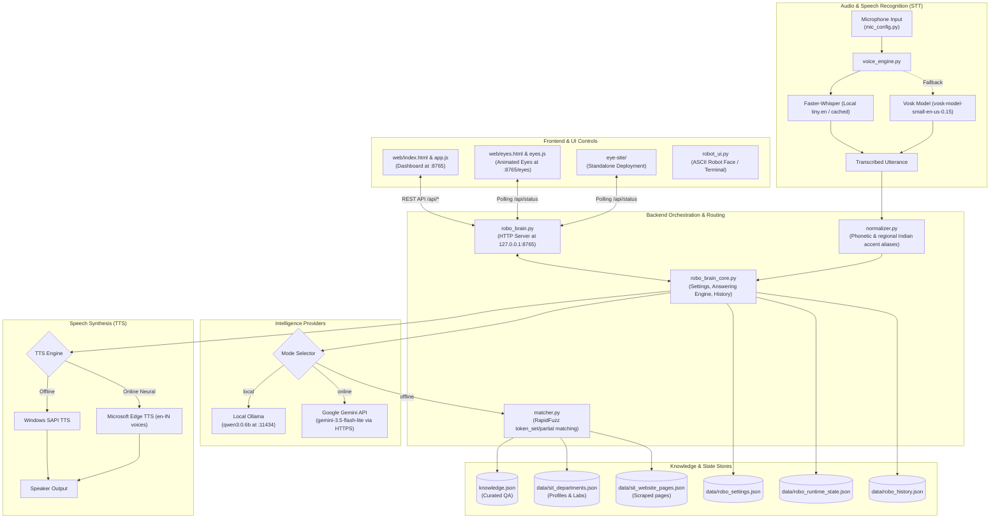

# PROJECT AUDIT & SYSTEM ARCHITECTURE
## SIT Tumakuru Humanoid Campus Assistant (Robo)

---

## 1. System Overview

Robo is a hybrid voice-interactive and web-controlled conversational assistant deployed on a humanoid robot at **Siddaganga Institute of Technology (SIT), Tumakuru**. The system supports:
- **100% Offline operation**: Local Speech-to-Text (Whisper / Vosk), fuzzy-matcher retrieval against curated SIT data (`knowledge.json`, scraped pages, and department profiles), and Windows SAPI TTS.
- **Local AI generation**: On-device Ollama model (e.g. `qwen3:0.6b`).
- **Cloud AI generation**: Google Gemini API via OpenAI-compatible endpoints with local knowledge grounding.
- **Operator & Visual Display Plane**: Local web dashboard (`http://127.0.0.1:8765`) and real-time animated robotic eye display (`/eyes`).

---

## 2. Complete Architecture Map

---

## 3. Communication Pathways & Data Flow

1. **Voice Input Flow**:
   - `bot.py` reads microphone stream via `voice_engine.listen()`.
   - `voice_engine.py` attempts decoding with Faster-Whisper; falls back to chunked Vosk Kaldi recognizer if Whisper fails.
   - Decoded string is normalized in `normalizer.py` (e.g., correcting acoustic aliases like *"bella auditor young"* $\rightarrow$ *"Birla Auditorium"*).
   - `robo_brain_core.py` routes the normalized query according to the selected mode (`offline`, `local`, or `online`).

2. **Knowledge Retrieval Flow**:
   - In `offline` mode, `matcher.py` searches `knowledge.json`, `sit_departments.json`, and `sit_website_pages.json` using RapidFuzz ratio metrics.
   - In `local` or `online` mode, the matched local SIT answer is injected as grounding context into the prompt sent to the LLM.

3. **Status & Eye Synchronization**:
   - `bot.py` calls `core.publish_runtime(phase, ...)`, which writes to `data/robo_runtime_state.json`.
   - The web dashboard (`app.js`) and animated eye panel (`eyes.js`) poll `/api/status` to synchronize eye movements, states (`sleeping`, `listening`, `thinking`, `speaking`), and live transcript feeds.
